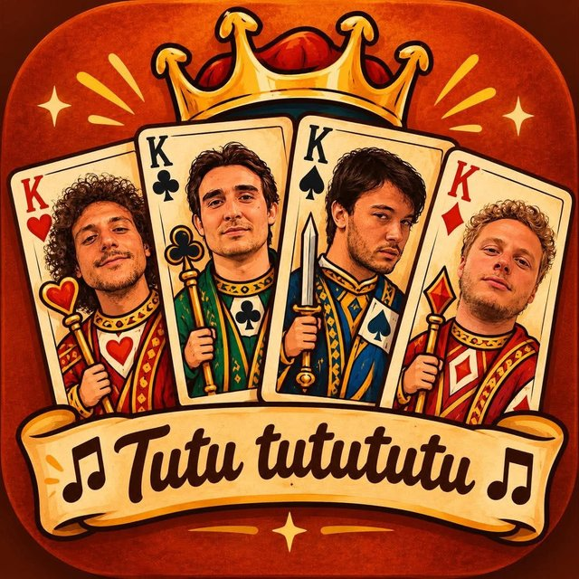
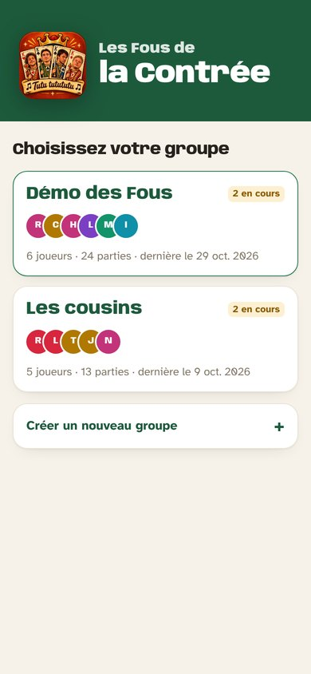
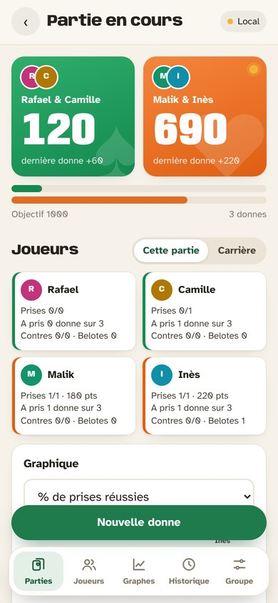
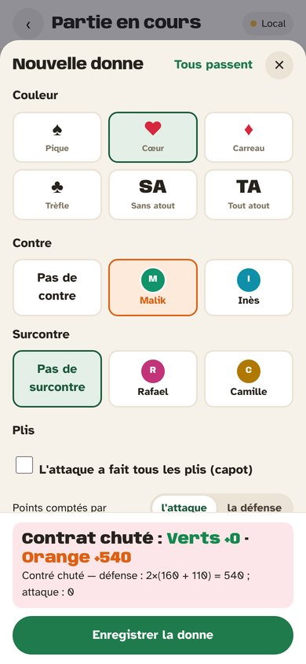
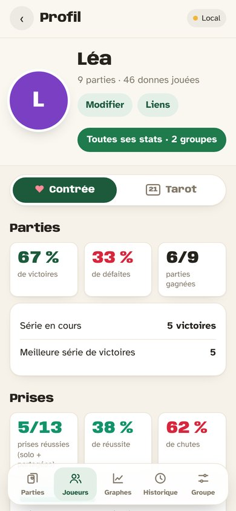
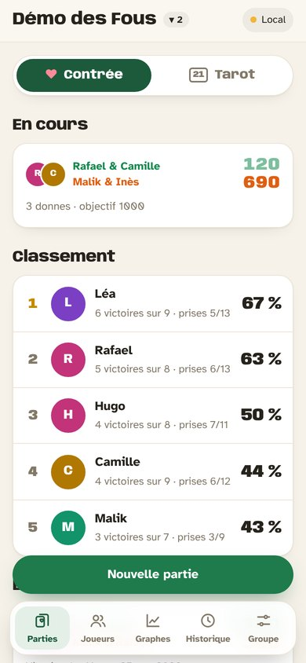
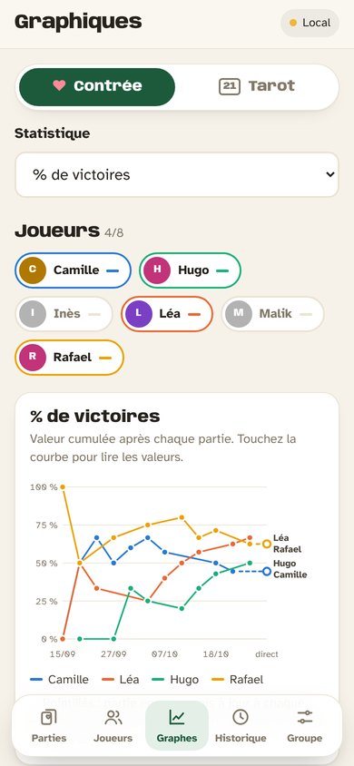
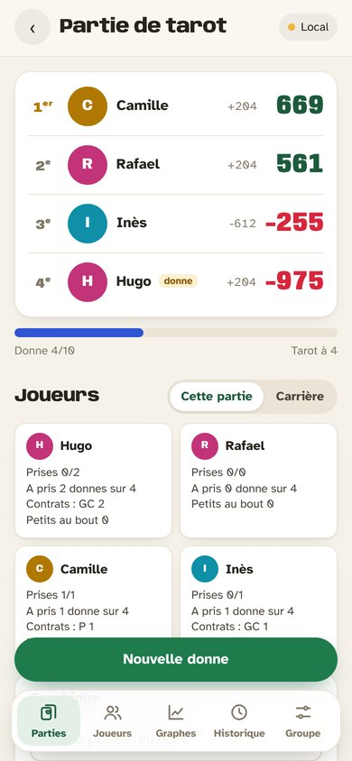

  

<h1 align="center">Les Fous de la Contrée</h1>

  <b>Le carnet de scores de la contrée et du tarot, dans la poche de chaque joueur.</b> 
  On compte les points sans se tromper, et chacun suit ses statistiques partie après partie.

  
  
  
  

---

## À quoi ça sert

Autour de la table, une seule personne note les donnes sur son téléphone. L'application calcule les points, annonce la fin de la partie, et tout le groupe voit les mêmes scores en direct sur son propre téléphone. Au fil des soirées, elle garde l'historique de chaque joueur : qui prend le plus, qui réussit ses contrats, qui contre à bon escient, avec quel partenaire on gagne.

Elle s'installe sur iPhone et Android depuis le navigateur (« Ajouter à l'écran d'accueil »), sans passer par un store. Elle fonctionne aussi sans réseau : les donnes partent dès que la connexion revient.

## Ce qu'elle fait

### Compter les points de la contrée

- Saisie d'une donne en quelques touches : preneur, annonce (80 à 160, capot, générale), couleur, contre, surcontre, points faits, belote.
- Le résultat s'affiche **avant** d'enregistrer : « Contrat réussi : Verts +210 · Orange +50 ».
- Barème de la Fédération Française de Belote : donne contrée ou surcontrée, le camp qui a raison prend tout, (160 + annonce) × 2 ou × 4. L'ancienne façon de compter reste disponible.
- Prise à deux : quand le partenaire avait aussi annoncé, la prise compte pour les deux.
- **Couleurs d'équipe au choix** à chaque partie (bleu, rouge, vert, orange, violet, rose, jaune, turquoise, noir) ; le nom de l'équipe suit sa couleur.
- Score à atteindre réglable, fin de partie automatique, revanche en un geste, titre de partie (« Finale de Noël »).

### Compter les points du tarot

- À 3, 4 ou 5 joueurs (appel au roi), barème de la Fédération Française de Tarot : Petite, Garde, Garde sans, Garde contre, petit au bout, poignées, chelem, misères en option.
- Partie en nombre de donnes fixé ou libre, classement et podium.

### Suivre les statistiques

- **Profil de chaque joueur** avec sa photo : victoires, prises réussies, points moyens par contrat, annonce moyenne, contres réussis, chutes infligées en défense, belotes, capots, meilleur partenaire et adversaire redouté. Au tarot : niveau de ses prises (Petite, Garde…), place moyenne, podiums, petits au bout…
- **Stats d'une partie** : touchez un joueur pendant la partie pour voir sa fiche détaillée sur cette partie seulement, ou basculez sur sa carrière.
- **Graphes** : choisissez une statistique et les joueurs à comparer, et suivez leur évolution partie après partie. Pendant une partie, une courbe par joueur se met à jour à chaque donne.
- **Export CSV** des statistiques et de toutes les donnes, pour Excel.

### Jouer à plusieurs, en plusieurs groupes

- Un **code d'invitation** par groupe : les autres joueurs installent l'app, entrent le code et retrouvent les mêmes profils et scores.
- Plusieurs groupes sur le même téléphone (les amis du jeudi, la famille…). À l'ouverture, l'app propose de **choisir son groupe**.
- Un même joueur peut être relié d'un groupe à l'autre : même photo partout, et « Toutes ses stats » additionne ses résultats.
- Reprendre en un geste les joueurs d'un autre groupe pour en créer un nouveau.

  
  
  

## Personnaliser

- Le **logo** affiché à l'ouverture se change en remplaçant `img/logo.jpg` (ou en indiquant une autre image dans `js/config.js`).
- Chacun choisit la **couleur du bandeau** sur son téléphone (Groupe → Apparence) : clair, vert, noir, bordeaux, bleu nuit ou sauge.
- Les **couleurs** de l'app (fond crème, accent vert) sont réunies dans `css/app.css`.

Le détail est dans le [guide d'utilisation](docs/GUIDE.md#modifier-le-design).

## Documentation

- [Guide d'utilisation](docs/GUIDE.md) : saisie, règles de comptage avec exemples chiffrés, définition de chaque statistique, tarot, groupes, design.
- [Installation](docs/INSTALLATION.md) : mettre l'application en ligne pour un nouveau groupe (Supabase + GitHub Pages, gratuit, environ 20 minutes).

## Sous le capot

Application web installable (PWA) en JavaScript, sans dépendance ; données stockées sur le téléphone puis synchronisées dans une base Supabase, protégée par le code de groupe. Polices Anybody et Atkinson Hyperlegible (licence OFL).
